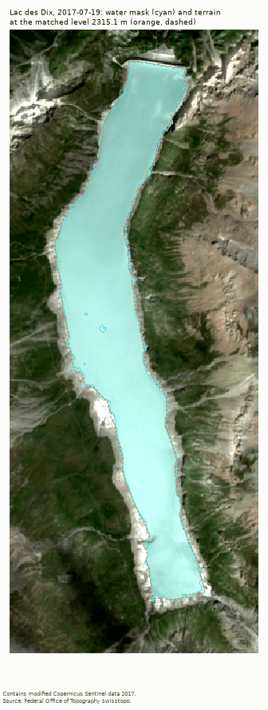

# alpine-hydro

Swiss hydro reservoirs hold about 8.9 TWh of energy, and how full they are shapes
Swiss power prices. This project has three parts. Part A, finished, is an experiment
in where free satellite data can and can't track Alpine storage: it reads water levels
of single reservoirs from Sentinel-2 and Landsat images and checks them against the
official weekly numbers of the Swiss Federal Office of Energy (SFOE). Part B is a
pre-registered test of whether the storage deviation predicts the Swiss minus German
day-ahead price spread. Part C asks whether satellite snow cover forecasts the summer refill.
**Price results come later**; nothing here is a price claim.


## Method (Part A)

- **Water masks.** Sentinel-2 (from 2017) and Landsat 8 and 9 (from 2013), June to
  November for the Alpine lakes. Clouds from Cloud Score+ and the Landsat QA band; a
  scene is used only if 90% of a 300 m buffer is clear. Water is MNDWI above a per-scene
  Otsu threshold, with NIR below 0.12 and terrain shadow removed.
- **Terrain.** swissALTI3D (2 m) above the flat lake surface it stores, an offset-corrected
  global DEM (SRTM or Copernicus GLO-30, 30 m) below that, and a fitted power-law curve
  at the bottom. This gives each lake a level-area-volume curve.
- **Level.** The level whose flooded terrain best matches the mask (intersection over
  union), checked against the median terrain height along the shoreline. Scenes where the
  two disagree by more than 3 m, or that show snow, lake ice or heavy shadow, are flagged
  and never used.
- **Energy.** Volume from the curve, then energy with the SFOE 2025 kWh per m³ of each
  reservoir. One scene per SFOE week (the closest ok scene within 3 days), no interpolation.
- **Validation.** Lac des Dix + Lac d'Emosson + Lac de Mauvoisin against SFOE Valais
  (Wallis), with only a scale and an offset fitted on earlier years, scored on weekly
  anomalies so the seasonal cycle cannot inflate the score.



## Part A results

**Valais validation: passes overall (R² 0.70, n 46), driven by the 2026 shortfall;
without 2026 R² is 0.41 (n 40).** The three lakes are scored on anomalies of SFOE
Valais on clear June to November weeks, against a mark of 0.50 (mean absolute error
2.7 points of capacity, 46 weeks from 2017/18 to 2025/26). Without Mauvoisin, whose
curve is the weakest, R² is 0.715 on 56 weeks. Without 2022 it is 0.74 (n 39), and
without the first, weakly calibrated year 2017/18 it is 0.74 (n 41). These are
robustness checks; the pass under the stated rule stands.

The pass rests on July and August (R² 0.66 and 0.89), when the lakes fill and years
differ by up to 17 points. In September and October the lakes are near full, SFOE
anomalies are small, and the satellite cannot see them (R² 0.01 and 0.44). Full
numbers, by month and per reservoir: [reports/results.md](reports/results.md).


Coverage is the real constraint. Even from July to October, only a third to a half of
the weeks have a usable scene for each lake, and only 54 weeks since 2013 had all three Valais
lakes usable at once.


## Part C: snow and refill

The published storage level is already known to the market, so an outsider's edge is
more likely in the inflow. Part C builds a daily snow series from MODIS (Terra and Aqua,
500 m, from February 2000) for all land at or above 1800 m in Wallis, Graubuenden and
Tessin, and asks, under an analysis plan frozen before any fit (`prereg/H3_ANALYSIS_PLAN.md`,
tag `v0.2-h3plan`), whether snow on 1 May forecasts how full those regions are at the end
of September, beyond what starting storage already says. **Verdict: no added skill from
snow.** Walk-forward over 2012 to 2026, the snow model beats storage alone (skill score
+0.18) and the 10-year average (+0.28), but the Clark-West p is 0.13 (0.27 after Holm
correction), so it could be luck. In 2026, the 1 May forecast was 82.6% against an actual
74.0%: snow pointed the right way, but the drought came in summer. Full results:
[reports/results.md](reports/results.md).


## Limitations

- **Ice and snow, December to May.** Lakes freeze or carry snow, so winter levels are
  flagged (snow, lake ice from an ERA5-Land frost test) and not used. Alpine lakes are
  only searched June to November, and June and November are still mostly unusable.
- **Terrain floor.** swissALTI3D stores each lake as a flat surface 1 to 10 m below full
  supply; below it the curve comes from a 30 m global DEM or a fitted shape. At Lac de
  la Gruyère this failed (fill marked not usable); Mauvoisin and Grimsel are indicative.
- **Mask edge bias.** Against lidar water levels, masks were 1.4% to 15% short of the
  true lake area, roughly one 10 m pixel along the shore. The shortfall is not consistent
  between lakes, so it is stated as an uncertainty, not corrected. It hides the top
  metres of level: Emosson's ok levels never pass 1920.4 m although full supply is 1930 m.
- **Estimated volumes and heads.** Volumes and energy coefficients come from public
  registers and the SFOE 2025 list, not from operators.
- **Valais only for validation.** SFOE publishes four regions. Only Valais has three
  measured lakes; Sihlsee and Gruyère are shown beside their region as a visual check.
- **Emosson and Lei.** Emosson is shared with France and SFOE counts only the Swiss share
  of its energy. Lago di Lei lies mostly in Italy but its water goes to Swiss plants, and
  the Swiss lidar covers only 2 of its 13 lake tiles.
- **Out of scope.** The Lei and Grimsel batches and an independent altimetry check
  (DAHITI) were not run: Part A closed after the Valais validation, and satellite work
  moves to snow cover (Part C).

**Upgrade path.** The main next fix is the swissSURFACE3D lidar. Its points carry the
flight date, and on that date several lakes were 3 to 11 m lower than the flat surface
in swissALTI3D (Dix, Gruyère in 2019, Lei, Grimsel, perhaps Mauvoisin). The lidar ground
points should map those banks at metre resolution and replace the 30 m DEMs exactly
where the curves are weakest. After that: a per-lake edge correction once enough lidar
dates are available, and Sentinel-1 radar for cloudy weeks.

## Pre-registration

The price test (Part B) is pre-registered and frozen at tag
[v0.1-prereg](https://github.com/gerardorosch02/alpine-hydro/tree/v0.1-prereg)
([prereg/PREREGISTRATION.md](prereg/PREREGISTRATION.md)). Part A's validation target is
its own and not part of the pre-registration. Price results come later.

## Data and licences

| Source | Used for | Committed |
|---|---|---|
| SFOE ogd17 weekly storage | Storage by region, validation | Yes, processed CSV |
| Copernicus Sentinel-2 | Water masks | Derived tables only |
| Landsat 8 and 9 (USGS) | Water masks | Derived tables only |
| swisstopo swissTLM3D, swissALTI3D, swissSURFACE3D | Outlines, terrain, survey dates | Outlines and derived curves only |
| SRTM, Copernicus DEM GLO-30 | Terrain below the swissALTI3D floor | Derived curves only |
| ERA5-Land (Copernicus Climate Change Service) | Frost days for the lake-ice flag; snow water equivalent (Part C) | Frost-day counts; regional daily SWE |
| MODIS MOD10A1/MYD10A1 v6.1 (NASA NSIDC) | Daily snow cover (Part C) | Regional daily means only |
| ENTSO-E, SMARD | Prices (Parts B and C) | No price series; 11 yearly mean spreads for H3b |

Credits: Source: Swiss Federal Office of Energy SFOE. Contains modified Copernicus
Sentinel data 2017-2026. Landsat courtesy of the U.S. Geological Survey. Source: Federal
Office of Topography swisstopo. Full terms and credit lines: [DATA_LICENCES.md](DATA_LICENCES.md).
Code: MIT.

## Reproduce

```
uv sync
uv run alpinehydro demo    # rebuilds every figure from committed data, no keys needed
uv run pytest
```
