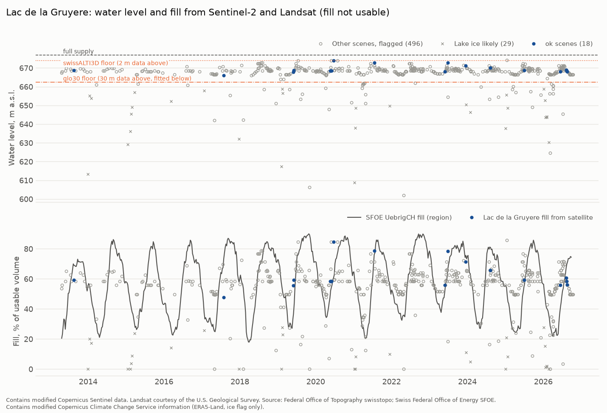

# Results

Weekend 1 (2026-10-20). No price slope, regression or price chart has been
computed. Machine-readable versions of the checks are in `reports/checks/`.

## Step 0 findings

**SFOE CSV is updating, but lags the PDF.** On 2026-10-20 the ogd17 CSV ended
at Datum 2026-09-28 (valid Sunday 2026-09-27), HTTP Last-Modified
Tue 29 Sep 2026 13:55 UTC. The 2026 weekly PDF (`12445-Montagswerte_12.10.2026.pdf`,
Last-Modified Tue 13 Oct 2026 09:48 UTC) already had 05.10 and 12.10.2026,
so the CSV was two weeks behind. Decision: CSV only for now, the release log
also watches the PDF, and a PDF parser is planned for weekend 6. Both files
have so far appeared on a Tuesday, earlier than the conservative Thursday
23:59 known_time used for history.

**Maximum capacity changes often.** TotalCH maximum moves between 8,500 GWh
(2000) and 8,900 GWh, with small steps up and down (8,820 in 2015/16,
8,895 since March 2023, 8,900 for September to December 2024). Fill is
always content over the same week's maximum.

**CH day-ahead prices on ENTSO-E** are continuous from 2015-01-01 00:00
Europe/Zurich. Before that only isolated days exist (2014-01-08, 2014-12-02,
2014-12-23). DE-LU, FR and IT-North are continuous from 2015-01-05. After
2015, no zone has a missing or partial delivery day up to 2026-10-21.
Note: entsoe-py returns empty hours as NaN rows, which made a first probe
look continuous from 2014-12-02; the counts above exclude NaN.

**ENTSO-E does carry a Swiss reservoir series** (`query_aggregate_water_reservoirs_and_hydro_storage`,
weekly, MWh), from 2015-02-23 to 2026-09-28, 603 weeks. It is not an
independent source. From the week of 2024-12-30 it equals SFOE TotalCH
exactly (mean absolute difference 0.0 GWh in 2025 and 2026). Before that it
is a different, smaller aggregate: 52% to 78% of the SFOE total by year
(median ratio), correlation with SFOE 0.965 to 0.998, mean absolute
difference 1,100 to 2,100 GWh. SFOE remains the primary series.

**ENTSO-E terms.** Terms of Use of 29 March 2023 and the "List of data
available for free re-use" of 18 October 2023:
https://transparencyplatform.zendesk.com/hc/en-us/articles/40921911218961-Legal-Terms-and-Conditions
Listed items are CC-BY 4.0. Day-ahead prices (article 12.1.d) and reservoir
filling (16.1.d) are not on the list, and clause 3.1 asks users to seek the
primary owner's agreement where re-use could harm their rights. So no
ENTSO-E price data of any kind are committed, including derived statistics
of price levels. Only statistics of my own data checks are committed.

**SMARD is a clean cross-check.** Market data are CC BY 4.0, credit
"Bundesnetzagentur | SMARD.de" (https://www.smard.de/home/datennutzung).
Hourly prices, 2018-10-01 to 2026-10-21, against ENTSO-E hourly means:

| Zone | Hours | Correlation | Mean abs. difference (EUR/MWh) | Max abs. difference |
|---|---|---|---|---|
| CH | 70,632 | 1.000000 | 0.0000 | 0.000 |
| DE-LU | 70,608 | 1.000000 | 0.0003 | 0.005 |
| FR | 70,632 | 1.000000 | 0.0003 | 0.005 |

Every hour matches to within EUR 0.01, including after the October 2025
switch to 15-minute products, so SMARD's hourly series equals the hourly
mean of the 15-minute ENTSO-E prices. Hour sets are identical.

## Current storage

Week ending Sunday 27 Sep 2026 (latest CSV week): TotalCH 6,588 GWh of
8,895 GWh, **74.1% full**. The 10-year past-only norm for that week is
85.2%, so the deviation is **-11.2 points**. The 20-year norm is 85.5%
(-11.5 points). The PDF shows 73.6% on 12.10.2026, not yet in the CSV.

2025/26 was below the 2000/01 to 2024/25 minimum for the same week in 17
weeks: 17 and 24 May, 21 and 28 June, and every week from 5 July to
27 September 2026. On 27 September it was 77.6% at the previous minimum,
3.5 points lower. This is a description of storage only, not a price claim.

## Timing ceiling (SFOE only, no prices)

Standard deviation of the week-on-week change in the deviation, November
to April, scaled to a 4-day head start and multiplied by the smallest
effect of interest (EUR 2/MWh per 10 points):

| Norm | Weekly changes | SD of weekly change (pp) | 4-day SD, linear (pp) | 4-day SD, square root (pp) | Ceiling, linear (EUR/MWh) | Ceiling, square root (EUR/MWh) |
|---|---|---|---|---|---|---|
| 10-year | 431 (2010-01 to 2026-04) | 1.50 | 0.86 | 1.14 | **0.17** | **0.23** |
| 20-year | 172 (2020-01 to 2026-04) | 1.44 | 0.82 | 1.09 | 0.16 | 0.22 |

Both ceilings are below EUR 0.5/MWh. The timing edge from a few days'
satellite head start is likely worthless. Part A should be framed as
per-reservoir detail (which reservoirs, which valleys, how they fill),
not as a faster version of the SFOE number.

## Part A: satellite storage (weekend 2, in progress)

The Wallis validation and the coverage figures will be added here when the
Dix, Emosson and Mauvoisin batches are done.

**Lac de la Gruyère: fill not usable.** Its scenes table is kept for the
coverage figure, but its levels and fill are not used. Two problems meet at
the same heights. Below the swissALTI3D floor (674.02 m), the GLO-30 band is
nearly flat: the lake area grows by only 0.02 km² per metre from 669 to
674 m, against 0.38 km² per metre in the 3 m above the floor. And the summer
water masks cover about 7.9 km², 3 to 5% short of the 8.30 km² lake at the
floor. On this curve that shortfall alone moves the level by about 6 m. The
result is a level series flat at 667 to 670 m all year, with no seasonal
cycle. Of 1,478 scenes, 543 were at least 90% clear; 18 were ok and 425 were
no_match.

