# Results

## Summary of results

One row per tested claim. Every number is copied from the detailed sections below, and
`tests/test_results_summary.py` checks that each one appears there unchanged.

| Claim | Plan and tag | Primary number | Verdict | Meaning |
|---|---|---|---|---|
| Part A: satellite Wallis storage tracks SFOE Wallis | Own validation target (not pre-registered) | R² of anomalies 0.695, n 46; 0.408 without 2026 (n 40) | Pass (mark 0.50) | Satellites track the summer refill in big years, but the pass leans on the 2026 drought. |
| A satellite head start on the SFOE release is worth something | Known before the freeze, `v0.1-prereg` section 7 | Timing ceiling EUR 0.17 to 0.23/MWh | Likely worthless | Seeing storage a few days early is worth far less than EUR 0.5/MWh. |
| H1: the storage deviation predicts the 28-day CH minus DE-LU spread, November to April | `prereg/PREREGISTRATION.md`, `v0.1-prereg` | Slope −7.72 EUR/MWh per 10 points; Clark-West p 0.030; out-of-sample R² vs B3 0.009 | No edge | Low storage goes with a higher Swiss premium, but the forecast gain over controls alone fails once the crisis winters are removed. |
| H2: the same deviation predicts the March to April CH minus IT-North spread | `v0.1-prereg`, details in deviation D8 | Slope +0.70 per 10 points; Clark-West p 0.987 | Null | No sign of an effect. |
| H3a: 1 May snow forecasts the end-of-September fill beyond starting storage | `prereg/H3_ANALYSIS_PLAN.md`, `v0.2-h3plan` | Skill vs C1 +0.175; Holm p 0.268 | No added skill from snow | Snow points the right way, but 15 test years cannot tell it apart from luck. |
| H3b: the 1 May forecast fill deviation predicts the October to December spread | `v0.2-h3plan` | Slope −36.9 EUR/MWh per 10 points; Holm p 0.058; smallest detectable effect 54.5 | Underpowered, not significant | The sign is the expected one, but 11 years cannot detect any plausible effect. |
| Post-hoc follow-up: a 1 July update (melt, rain, storage) adds skill | `prereg/H3_FOLLOWUP_PLAN.md`, `v0.3-followup-plan` | Skill vs C1 +0.012; Holm p 0.241 | No added skill after 1 May (post-hoc) | Summer weather terms do not explain the record-low 2026 refill. |
| Post-hoc water balance: was the 2026 storage shortfall weather or operators? | `prereg/WATER_BALANCE_PLAN.md`, `v0.4-waterbalance-plan` | Inflow share 7.01 at eta 0.75 (rule: at least 2/3); inflow anomaly −2,638 GWh, release anomaly −2,261 GWh, 29 March to 30 August | Weather story (post-hoc) | Less water came in than in any year since 2015, and operators released less, not more. |
| Live check 2026/27: the H1 model forecasts each live week | `v0.1-prereg` section 9 | No live origin yet; first is the week of Sunday 1 November 2026 | In progress | A record only; the live verdict comes after April 2027. |

Weekend 1 (2026-10-20). No price slope, regression or price chart has been
computed. Machine-readable versions of the checks are in `reports/checks/`.

## Step 0 findings

**SFOE CSV is updating, but lags the PDF.** On 2026-10-20 the ogd17 CSV ended
at Datum 2026-09-28 (valid Sunday 2026-09-27), HTTP Last-Modified
Tue 29 Sep 2026 13:55 UTC. The 2026 weekly PDF (`12445-Montagswerte_12.10.2026.pdf`,
Last-Modified Tue 13 Oct 2026 09:48 UTC) already had 05.10 and 12.10.2026,
so the CSV was two weeks behind. Decision: CSV only for now, the release log
also watches the PDF, and a PDF parser is planned for weekend 6. Both files
have so far appeared on a Tuesday, earlier than the conservative Thursday
23:59 known_time used for history.

**Maximum capacity changes often.** TotalCH maximum moves between 8,500 GWh
(2000) and 8,900 GWh, with small steps up and down (8,820 in 2015/16,
8,895 since March 2023, 8,900 for September to December 2024). Fill is
always content over the same week's maximum.

**CH day-ahead prices on ENTSO-E** are continuous from 2015-01-01 00:00
Europe/Zurich. Before that only isolated days exist (2014-01-08, 2014-12-02,
2014-12-23). DE-LU, FR and IT-North are continuous from 2015-01-05. After
2015, no zone has a missing or partial delivery day up to 2026-10-21.
Note: entsoe-py returns empty hours as NaN rows, which made a first probe
look continuous from 2014-12-02; the counts above exclude NaN.

**ENTSO-E does carry a Swiss reservoir series** (`query_aggregate_water_reservoirs_and_hydro_storage`,
weekly, MWh), from 2015-02-23 to 2026-09-28, 603 weeks. It is not an
independent source. From the week of 2024-12-30 it equals SFOE TotalCH
exactly (mean absolute difference 0.0 GWh in 2025 and 2026). Before that it
is a different, smaller aggregate: 52% to 78% of the SFOE total by year
(median ratio), correlation with SFOE 0.965 to 0.998, mean absolute
difference 1,100 to 2,100 GWh. SFOE remains the primary series.

**ENTSO-E terms.** Terms of Use of 29 March 2023 and the "List of data
available for free re-use" of 18 October 2023:
https://transparencyplatform.zendesk.com/hc/en-us/articles/40921911218961-Legal-Terms-and-Conditions
Listed items are CC-BY 4.0. Day-ahead prices (article 12.1.d) and reservoir
filling (16.1.d) are not on the list, and clause 3.1 asks users to seek the
primary owner's agreement where re-use could harm their rights. So no
ENTSO-E price data of any kind are committed, including derived statistics
of price levels. Only statistics of my own data checks are committed.

**SMARD is a clean cross-check.** Market data are CC BY 4.0, credit
"Bundesnetzagentur | SMARD.de" (https://www.smard.de/home/datennutzung).
Hourly prices, 2018-10-01 to 2026-10-21, against ENTSO-E hourly means:

| Zone | Hours | Correlation | Mean abs. difference (EUR/MWh) | Max abs. difference |
|---|---|---|---|---|
| CH | 70,632 | 1.000000 | 0.0000 | 0.000 |
| DE-LU | 70,608 | 1.000000 | 0.0003 | 0.005 |
| FR | 70,632 | 1.000000 | 0.0003 | 0.005 |

Every hour matches to within EUR 0.01, including after the October 2025
switch to 15-minute products, so SMARD's hourly series equals the hourly
mean of the 15-minute ENTSO-E prices. Hour sets are identical.

## Current storage

Week ending Sunday 27 Sep 2026 (latest CSV week): TotalCH 6,588 GWh of
8,895 GWh, **74.1% full**. The 10-year past-only norm for that week is
85.2%, so the deviation is **-11.2 points**. The 20-year norm is 85.5%
(-11.5 points). The PDF shows 73.6% on 12.10.2026, not yet in the CSV.

2025/26 was below the 2000/01 to 2024/25 minimum for the same week in 17
weeks: 17 and 24 May, 21 and 28 June, and every week from 5 July to
27 September 2026. On 27 September it was 77.6% at the previous minimum,
3.5 points lower. This is a description of storage only, not a price claim.

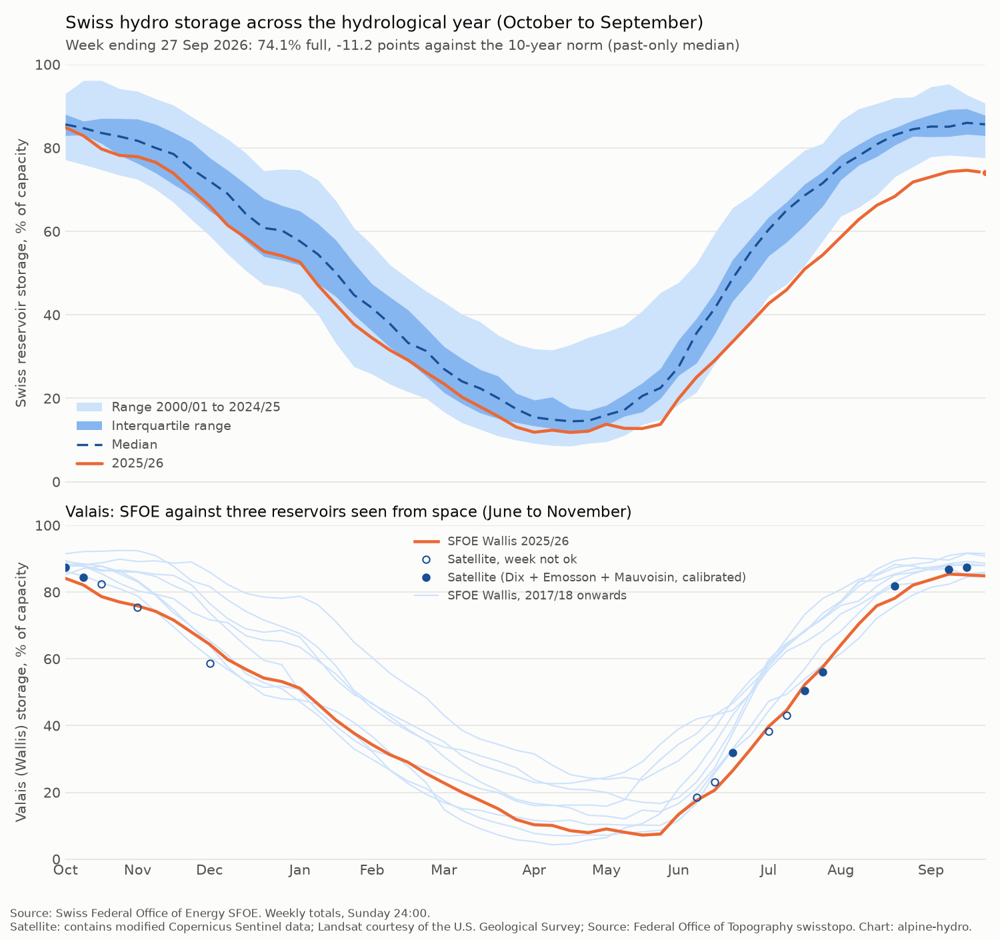

## Timing ceiling (SFOE only, no prices)

Standard deviation of the week-on-week change in the deviation, November
to April, scaled to a 4-day head start and multiplied by the smallest
effect of interest (EUR 2/MWh per 10 points):

| Norm | Weekly changes | SD of weekly change (pp) | 4-day SD, linear (pp) | 4-day SD, square root (pp) | Ceiling, linear (EUR/MWh) | Ceiling, square root (EUR/MWh) |
|---|---|---|---|---|---|---|
| 10-year | 431 (2010-01 to 2026-04) | 1.50 | 0.86 | 1.14 | **0.17** | **0.23** |
| 20-year | 172 (2020-01 to 2026-04) | 1.44 | 0.82 | 1.09 | 0.16 | 0.22 |

Both ceilings are below EUR 0.5/MWh. The timing edge from a few days'
satellite head start is likely worthless. Part A should be framed as
per-reservoir detail (which reservoirs, which valleys, how they fill),
not as a faster version of the SFOE number.

## Part A: satellite storage (weekend 2, closed)

Part A was an experiment in where free satellite data (Sentinel-2 from 2017,
Landsat 8 and 9 from 2013) can and can't track Alpine storage. Water masks
come from MNDWI with a per-scene Otsu threshold. A level is read by matching
each mask to terrain from swissALTI3D, a global DEM and a fitted curve, and
volume and energy follow from the reservoir's curve and energy coefficient.
Machine-readable results: `reports/checks/wallis_validation.json`,
`data/processed/satellite/`.

### Wallis validation: pass

Satellite Wallis is the energy sum of Lac des Dix, Lac d'Emosson and Lac de
Mauvoisin, calibrated to SFOE Wallis with only a scale and an offset, walk-forward
by hydrological year. The first year (2013/14, 2 ok weeks) is in-sample and left
out. Scored on anomalies (deviation from the same week's mean across the other
years) for June to November weeks where all three lakes have an ok scene within
3 days of the SFOE week end.

| | R² of anomalies | MAE (pp of capacity) | Fill bias (pp) | Fill MAE (pp) | n weeks | Result |
|---|---|---|---|---|---|---|
| **Dix + Emosson + Mauvoisin** | **0.695** | 2.67 | +0.31 | 2.04 | 46 | **pass** (mark 0.50) |
| Sensitivity: without Mauvoisin | 0.715 | 3.33 | +0.98 | 2.56 | 56 | pass |

The sensitivity drops Mauvoisin, whose fill is indicative. It is a check, not
the main result. Scored years run from 2017/18 to 2025/26. The anomaly bias is
zero by construction (leave-one-year-out anomalies sum to zero each week), so
the table gives the bias and error of the calibrated fill itself.

By month (main result). No June or November week had all three lakes ok.

| Month | n | R² | MAE (pp) | SD of SFOE anomaly (pp) |
|---|---|---|---|---|
| July | 9 | 0.66 | 4.64 | 9.1 |
| August | 11 | 0.89 | 2.27 | 7.8 |
| September | 12 | 0.01 | 2.46 | 3.0 |
| October | 14 | 0.44 | 1.91 | 3.0 |

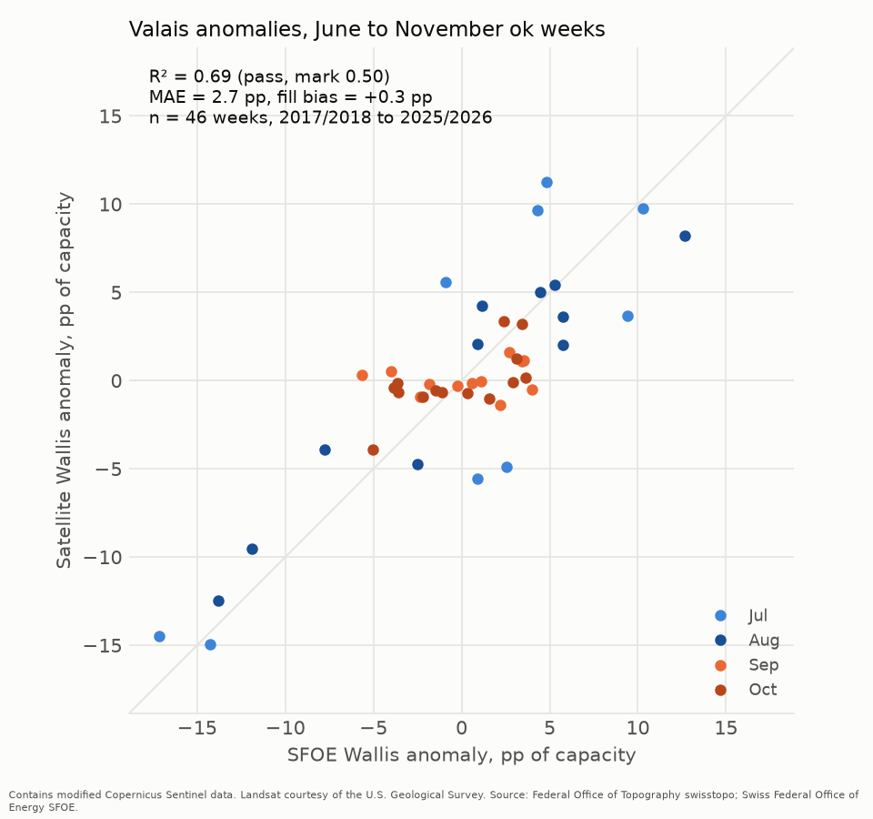

**What worked and what failed.** The pass rests on July and August, when the
lakes are filling and years differ by up to 17 points. In late July 2026, for
example, SFOE Wallis was 14 to 17 points below the same weeks of other years and
the satellite showed 15 points below; in early August 2024 SFOE was 13 points
above and the satellite 8 above. In September and October the lakes sit near
full and SFOE anomalies are small (SD 3 pp). The satellite cannot see them,
because near the top the masks run a few percent short of the true area along
the shore, and that shortfall hides the last metres of level. At Emosson,
ok levels never pass the swissALTI3D floor (1920.4 m) although full supply is
1930 m. June and November fail for a different reason: snow, lake ice and
cloud, so no week has all three lakes clear. Only 54 of the weeks since 2013
had all three lakes ok, and the sample is small: 46 scored weeks over 13
calendar weeks. The first out-of-sample year (2017/18) is calibrated on just
2 Landsat weeks.

**Robustness checks (added 2026-10-21, weekend 3).** These do not change the
pass recorded under the stated rule. Each drops some weeks from the scored set
and recomputes the anomalies on the weeks that remain; the walk-forward
calibration is unchanged (`reports/checks/wallis_robustness.json`).

| Check | R² of anomalies | MAE (pp) | n weeks |
|---|---|---|---|
| Stated result, all scored weeks | 0.695 | 2.67 | 46 |
| Without calendar year 2026 (the most extreme year) | 0.408 | 2.75 | 40 |
| Without calendar year 2022 | 0.743 | 2.59 | 39 |
| Without the first scored year 2017/18 (calibrated on 2 Landsat weeks) | 0.744 | 2.80 | 41 |

Without 2026 the R² falls below the 0.50 mark. The 2026 drought summer, with
SFOE Wallis 14 to 17 points below other years in late July, carries a large
part of the result. Dropping 2022 or the weakly calibrated first year does not
weaken it.

**Stated uncertainty: mask edge bias.** Against lidar water levels on the
flight day, the masks were 1.4% to 15% short of the true lake area
(clean tests at Sihlsee, Gruyère and Emosson; `reports/checks/mask_edge_bias.json`).
The shortfall is not consistent between lakes, so it is not corrected. It is
roughly one 10 m pixel along the whole shore, more on steep wooded banks.

### Coverage

Share of SFOE weeks (from April 2017, in searched months) whose closest scene
within 3 days falls in each class:

| Reservoir | ok | Level not trusted | Ice or snow | Cloud | No scene |
|---|---|---|---|---|---|
| Sihlsee (all months) | 28% | 22% | 15% | 33% | 1% |
| Lac de la Gruyère (all months) | 3% | 46% | 5% | 45% | 1% |
| Lac des Dix (June to November) | 40% | 8% | 8% | 41% | 4% |
| Lac d'Emosson (June to November) | 33% | 10% | 7% | 50% | 1% |
| Lac de Mauvoisin (June to November) | 37% | 4% | 17% | 39% | 4% |

Share of weeks with an ok scene, by month:

| Month | Dix | Emosson | Mauvoisin |
|---|---|---|---|
| June | 33% | 12% | 14% |
| July | 55% | 36% | 34% |
| August | 39% | 55% | 45% |
| September | 42% | 47% | 51% |
| October | 48% | 42% | 52% |
| November | 21% | 3% | 21% |

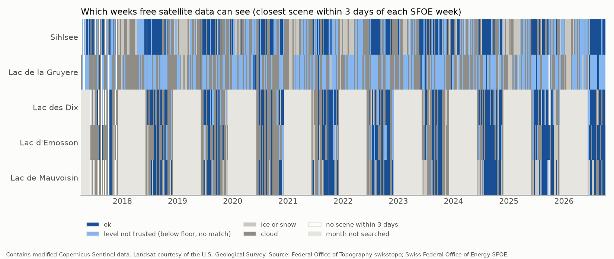

### Fill quality per reservoir

- **Lac de la Gruyère: fill not usable.** Its scenes table is kept for the
  coverage figure, but its levels and fill are not used. Two problems meet at
  the same heights. Below the swissALTI3D floor (674.02 m), the GLO-30 band is
  nearly flat: the lake area grows by only 0.02 km² per metre from 669 to
  674 m, against 0.38 km² per metre in the 3 m above the floor. And the summer
  water masks cover about 7.9 km², 3 to 5% short of the 8.30 km² lake at the
  floor. On this curve that shortfall alone moves the level by about 6 m. The
  result is a level series flat at 667 to 670 m all year.
- **Lac de Mauvoisin: indicative.** Its fitted curve hit the lower bound b = 1,
  27% of its usable volume is fitted, and its curve failed the continuity check
  (ratio 0.23 against a mark of 0.25).
- **Grimsel: indicative** (continuity ratio 0.248). Not run this weekend.
- Lei and Grimsel batches and the DAHITI altimetry check are out of scope:
  Part A closed after the Wallis validation.
- Sihlsee is shown beside the SFOE "rest of Switzerland" region as a visual
  check only. One lake cannot stand in for a region.

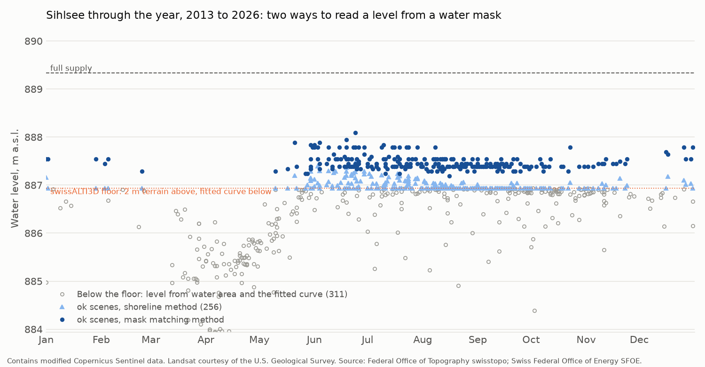

## H1 price test (weekend 3, pre-registered)

**Verdict: no edge.** Decided mechanically by line 3 of the frozen no-edge rule:

> The effect disappears without the crisis winters 2021/22 and 2022/23, or the full model
> beats B3 out of sample in fewer than 3 of the 5 test winters (2021/22 to 2025/26).
> […] In the crisis-excluded variant the full model must also beat B3 out of sample in at
> least 2 of the 3 test winters.

Without the crisis winters the full model beat B3 in only **1 of 3** test winters
(2024/25; not 2023/24 or 2025/26). Lines 1 and 2 do not hold: Clark-West p = 0.030 and
the out-of-sample R² against B3 is 0.009, and the slope interval lies outside the
equivalence band.

**Effect:** storage 10 points below its norm goes with a CH minus DE-LU spread
**7.7 EUR/MWh higher** over the next 28 days (slope −7.72 EUR/MWh per 10 points,
95% interval −13.19 to −2.25, Newey-West lag 4, 285 origins, 2015/16 to 2025/26). The sign
is the pre-registered one. **Smallest detectable effect:** 7.8 EUR/MWh per 10 points
(5% two-sided, 80% power, from the lag-4 standard error). Without the crisis winters the
slope is −3.58 per 10 points (95% −5.53 to −1.64), with a smallest detectable effect of
2.8.

Sample: 285 origins with a complete 28-day target, winters 2015/16 to 2025/26; 129 test
origins in the 5 test winters. No origin was dropped for control coverage (D9). Machine-
readable results: `reports/checks/h1_results.json`. Price series are never committed.

### Every pre-registered test, in the order of section 4

**1. Newey-West slope.** Lag 4 (primary): −0.772 EUR/MWh per point, standard error 0.279,
p = 0.006. Lag 8 (robustness): standard error 0.340, p = 0.023.

**2. Clark-West, full model against B3** (nested, one-sided): t = 1.89, **p = 0.030**.

**3. Diebold-Mariano with the Harvey-Leybourne-Newbold correction** (negative statistic =
the full model is more accurate):

| Against | Statistic | p (two-sided) | Reading |
|---|---|---|---|
| B0, seasonal norm | +2.73 | 0.007 | the full model is significantly **worse** than the monthly mean |
| B1, last 28 days | −1.42 | 0.158 | not significant |
| B2, persistence plus seasonal change | −1.20 | 0.231 | not significant |

**4. Out-of-sample R²** (primary: test y clipped at training cut-offs, D2; robustness:
raw test y):

| Against | Clipped y (primary) | Raw y (robustness) |
|---|---|---|
| B3, controls only | **0.009** | 0.023 |
| B0, seasonal norm | −0.490 | −0.142 |
| B1, last 28 days | 0.472 | −1.391 |
| B2, persistence plus seasonal change | 0.406 | −1.611 |

The training cut-offs clipped 21 of the 25 test targets in 2021/22 (cut-off 31.4 EUR/MWh;
raw targets reached 89). They clipped none in 2022/23, whose training already included
2021/22, 5 in 2023/24 and 1 in 2024/25. The sign of the R² against B1 and B2 depends on
this clipping; against B3 it does not.

**5. Bootstrap over whole winters** (2,000 resamples, D7): slope 95% interval −17.32 to
+1.90 EUR/MWh per 10 points, which includes zero; out-of-sample R² against B3, −0.253 to
+0.190. Five test winters give only 126 distinct resamples.

**6. Holm correction (secondary tests).** Family so far: H2 only; recomputed when H3b and
N1 are added. See H2 below; the updated table (H2, H3a, H3b) is in Part C.

**7. Crisis variants:**

| Variant | Slope per 10 points | Out-of-sample R² vs B3 | Wins vs B3 | Reading |
|---|---|---|---|---|
| Full sample | −7.72 (95% −13.19 to −2.25) | 0.009 | 3 of 5 (2021/22, 2022/23, 2024/25) | meets lines 1 and 3a |
| 2021/22 and 2022/23 excluded (D4), test 2023/24 to 2025/26 | −3.58 (95% −5.53 to −1.64) | 0.083 | **1 of 3** (2024/25) | same sign, R² above zero, but fails the 2-of-3 check |
| Crisis interaction (D11) | −4.40 outside crisis winters, −14.33 in them | n/a | n/a | interaction p = 0.002: the crisis winters carry a much steeper slope |

**8. Explanatory variant, realised controls** (not a forecast): slope −9.20 EUR/MWh per
10 points (95% −13.13 to −5.27); out-of-sample R² against B3 0.238; Clark-West p < 0.001;
wins 3 of 5. Knowing the window's realised nuclear output, wind and temperature does not
remove the storage effect.

**Equivalence (rule line 2).** TOST against ±0.2 EUR/MWh per point: p = 0.980; the 95%
interval is far outside the band, so "no effect" is not shown either.

**Per-winter count, full model against B3:** 3 of 5 (meets the 3-of-5 threshold).

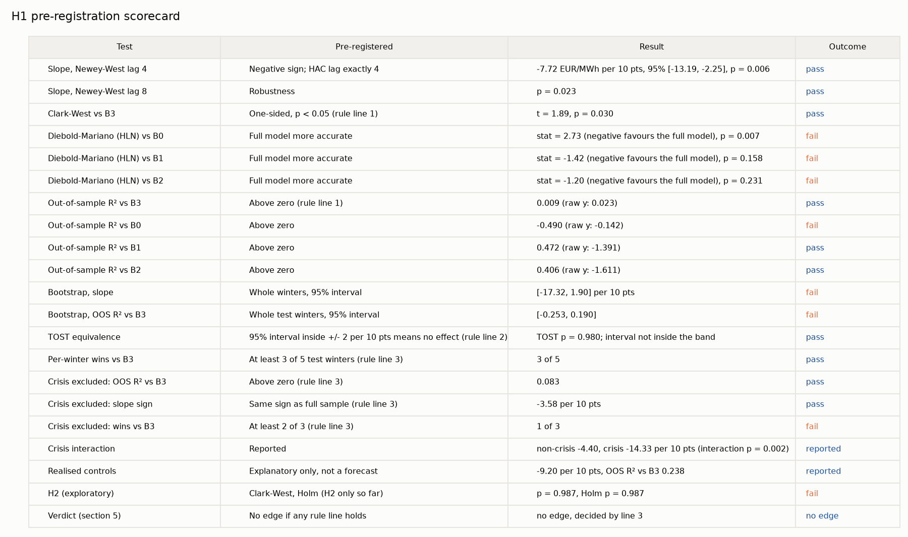

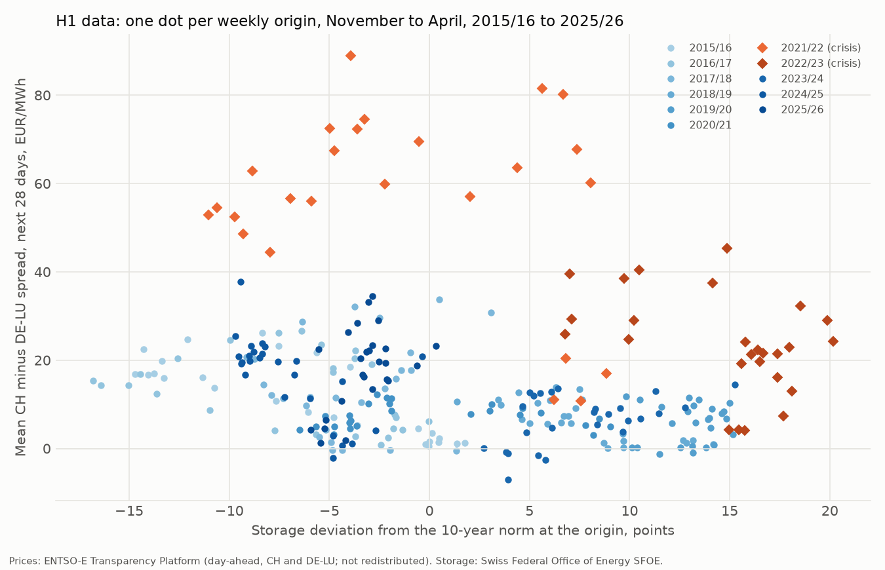

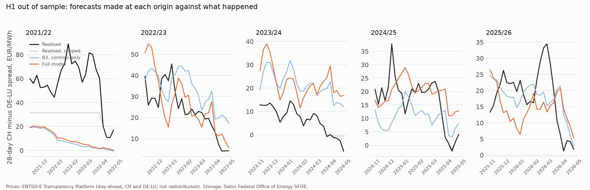

### H2 (exploratory): March to April CH minus IT-North

96 origins (valid Sunday in March or April), 44 test origins. Slope +0.70 EUR/MWh per
10 points (95% −3.81 to +5.21, p = 0.76). Clark-West against B3: t = −2.23, one-sided
p = 0.987; out-of-sample R² against B3 −0.143. Holm-adjusted p (family: H2 only so far) =
0.987. No sign of an effect.

### Live check 2026/27

Pre-registration section 9. Each SFOE week with a valid Sunday from November 2026 to
April 2027 gets one forecast of the next 28-day mean CH minus DE-LU spread, from the full
H1 model and B3 trained on the winters 2015/16 to 2025/26. known_time is when the week was
first seen (the weekly PDF, through `sfoe_pdf_log.csv`, is about two weeks ahead of the
CSV). The HDD controls of live origins come from the CDS (deviation D15). The realised
mean spread is filled in once the whole 28-day window has passed. Run by
`alpinehydro weekly`; log in [weekly_log.md](weekly_log.md).

**Rule.** The live winter does not enter the no-edge rule, which was decided on the five
test winters. The full live verdict is reported only after April 2027, once the last
window of an April origin has passed. Until then the table below is a record, not a
result: no claim is made from a partial winter.

Status on 2026-10-21: the latest SFOE week is Sunday 11 October 2026 (from the PDF; the
CSV ends at 27 September). No live origin yet. The first is the week of Sunday
1 November 2026. The forecast is made on the first weekly run after SFOE publishes that
week. A dry run on 2026-10-21, with that week injected in memory, reached the controls
and was refused only because the Earth Engine HDD window was under the 90% floor, which
led to D15. Check of D15 on 71 days held by both routes (August to 11 October 2026): the
CDS country mean temperature differs from Earth Engine by at most 0.07 C for CH (mean
−0.05 C) and 0.007 C for DE. CDS ran to 16 October, Earth Engine to 11 October.

| Valid Sunday | known_time | Window | Full model (EUR/MWh) | B3 (EUR/MWh) | Realised (EUR/MWh) |
|---|---|---|---|---|---|
| none yet | | | | | |

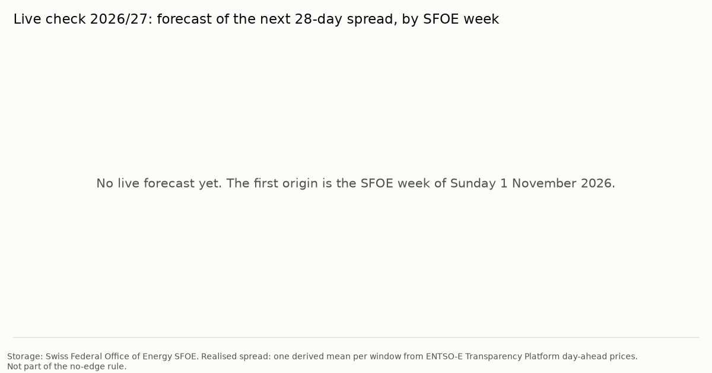

## Part C: snow and refill (weekend 4, H3 analysis plan)

The details of H3a and H3b were fixed in `prereg/H3_ANALYSIS_PLAN.md` and frozen as tag
`v0.2-h3plan` before any snow series was computed. Everything below follows that plan;
the choices it left open are listed under "Deviations from the H3 analysis plan" at the
end of this file. Machine-readable results: `reports/checks/h3_results.json`. Committed
inputs: `data/processed/snow/` (daily MODIS and ERA5-Land series, the feature table and one
October to December spread per year; no price series).

### H3a verdict: no added skill from snow

The primary version (three-region total, MODIS, 1 May issue, 1800 m band, end-of-September
fill, walk-forward) has a skill score against C1 of **+0.175**, which is above 0, but its
Clark-West p is **0.134** and its Holm-adjusted p is **0.268**. The pass mark needs both a
positive skill score and a Holm-adjusted p below 0.05, so the verdict is **"no added skill
from snow"**.

Snow moved the forecast the right way more often than not (RMSE 3.25 points against 3.58
for C1 and 3.84 for C0), but 15 test years are too few to tell that apart from luck.

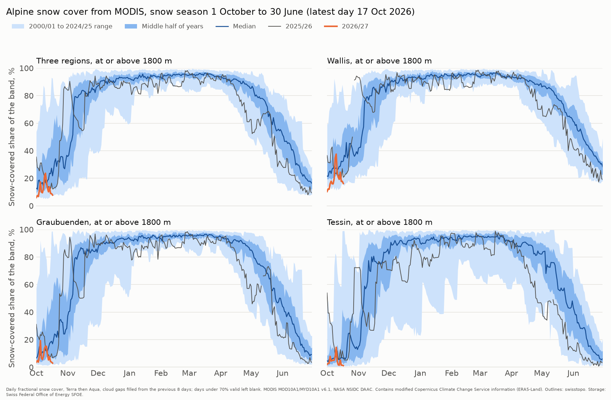

### Every H3a test, in the plan's order

Sample: years 2001 to 2026. MODIS has only 2 valid days in the 1 May 2001 window (the plan
needs 4), so 2001 is dropped from the MODIS 1 May models. With at least 10 training years
the first MODIS test year is then 2012, not 2011 (15 test years, deviation P3). The
ERA5-Land versions keep 2011 to 2026 (16 test years). In the full-sample fit of the
primary version, end-of-season fill rises by 19.8 points per unit of FSC, so about
**+2.0 points per 10 points of snow cover** (starting storage: +0.32 per point).

**1. Walk-forward skill scores (primary scoring).**

| Version | Skill vs C1 | Skill vs C0 | RMSE full / C1 / C0 (points) |
|---|---|---|---|
| **Primary: Total, MODIS, 1 May, 1800 m** | **+0.175** | **+0.282** | 3.25 / 3.58 / 3.84 |

**2. Clark-West, full model against C1** (one-sided, t with n − 1 df): t = 1.15,
**p = 0.134**, n = 15.

**3. Diebold-Mariano against C0** (Harvey-Leybourne-Newbold, h = 1, two-sided):
statistic −0.88 (negative means the snow model is more accurate), p = 0.394.

**4. Leave-one-year-out (secondary scoring, not a forecast claim)**, 2002 to 2026, n = 25:
skill vs C1 +0.135, vs C0 +0.190; Clark-West p = 0.018; Diebold-Mariano −0.93 (p = 0.363).
With every other year available for fitting, the snow term clears Clark-West. As a real
forecast it does not.

**5. Secondary versions (no multiple-testing correction).** Total region, end-of-September
fill, walk-forward (WF) and leave-one-year-out (LOYO). "ERA5-Land anomaly" is the
robustness version with a strict trailing 10-year anomaly.

| Source | Issue | Band | Test years | WF skill vs C1 | WF skill vs C0 | WF CW p | WF DM vs C0 (p) | LOYO skill vs C1 | LOYO CW p |
|---|---|---|---|---|---|---|---|---|---|
| **MODIS** | **1 May** | **1800** | **15 (2012-2026)** | **+0.175** | **+0.282** | **0.134** | **−0.88 (0.394)** | **+0.135** | **0.018** |
| ERA5-Land | 1 May | 1800 | 16 (2011-2026) | +0.190 | +0.291 | 0.048 | −1.13 (0.275) | +0.138 | 0.023 |
| ERA5-Land anomaly | 1 May | 1800 | 16 (2011-2026) | +0.135 | +0.243 | 0.041 | −1.01 (0.330) | +0.107 | 0.026 |
| MODIS | 1 May | 2000 | 15 (2012-2026) | +0.200 | +0.304 | 0.123 | −0.97 (0.351) | +0.116 | 0.017 |
| ERA5-Land | 1 May | 2000 | 16 (2011-2026) | +0.186 | +0.287 | 0.048 | −1.14 (0.273) | +0.132 | 0.024 |
| MODIS | 1 April | 1800 | 15 (2012-2026) | −0.014 | +0.136 | 0.137 | −0.54 (0.599) | +0.120 | 0.037 |
| ERA5-Land | 1 April | 1800 | 16 (2011-2026) | +0.063 | +0.214 | 0.093 | −1.74 (0.103) | −0.009 | 0.208 |
| MODIS | 1 April | 2000 | 15 (2012-2026) | +0.181 | +0.302 | 0.100 | −1.28 (0.223) | +0.104 | 0.067 |
| ERA5-Land | 1 April | 2000 | 16 (2011-2026) | +0.061 | +0.212 | 0.094 | −1.74 (0.101) | −0.012 | 0.221 |

*MODIS against ERA5-Land.* On 1 May they are close (skill vs C1 +0.18 and +0.19).
ERA5-Land has one more test year (2011) and a nominal Clark-West p just under 0.05, but it
is a secondary version and nothing in this table is corrected for the number of versions.
*1 April against 1 May.* 1 May is better for both sources. On 1 April the MODIS 1800 m
version has no skill against C1 (−0.01): snow cover at 1800 m is still near 90% in most
years and says little about the melt to come. The 2000 m band does better on 1 April
(+0.18). *ERA5-Land strict anomaly:* slightly weaker than raw SWE (+0.135 against +0.190),
so the raw-value choice did not flatter ERA5-Land. ERA5-Land SWE in Wallis never falls
below about 1,430 mm, even in summer, because the glacier cells of ERA5-Land hold a large
constant snowpack. The intercept absorbs that constant.

By region (1 May, 1800 m, walk-forward skill vs C1 / Clark-West p):

| Region | MODIS | ERA5-Land |
|---|---|---|
| Wallis | −0.036 / 0.572 (14 test years; 2001 and 2012 dropped) | −0.043 / 0.657 |
| Graubuenden | −0.184 / 0.313 | −0.188 / 0.438 |
| Tessin | +0.423 / 0.044 (2019 dropped) | +0.241 / 0.032 |
| Total | +0.175 / 0.134 | +0.190 / 0.048 |

Wallis and Graubuenden show no skill. Tessin, the smallest and lowest region (33% of the
canton is above 1800 m), shows the most.

*Refill target (GWh, spring minimum to end of September), 1 May, 1800 m:*

| Region | MODIS skill vs C1 / vs C0 / CW p | ERA5-Land skill vs C1 / vs C0 / CW p |
|---|---|---|
| Total | +0.060 / +0.657 / 0.255 | +0.094 / +0.668 / 0.118 |
| Wallis | −0.056 / +0.781 / 0.807 | −0.035 / +0.808 / 0.659 |
| Graubuenden | −0.251 / +0.393 / 0.353 | −0.209 / +0.413 / 0.464 |
| Tessin | +0.345 / +0.394 / 0.049 | +0.212 / +0.256 / 0.045 |

For refill, starting storage (C1) already beats climatology by a wide margin, and snow
adds little on top except in Tessin.

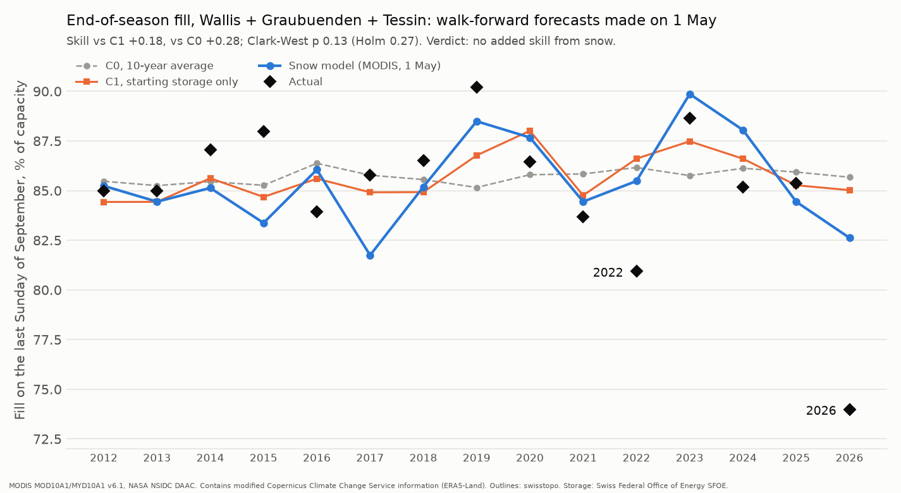

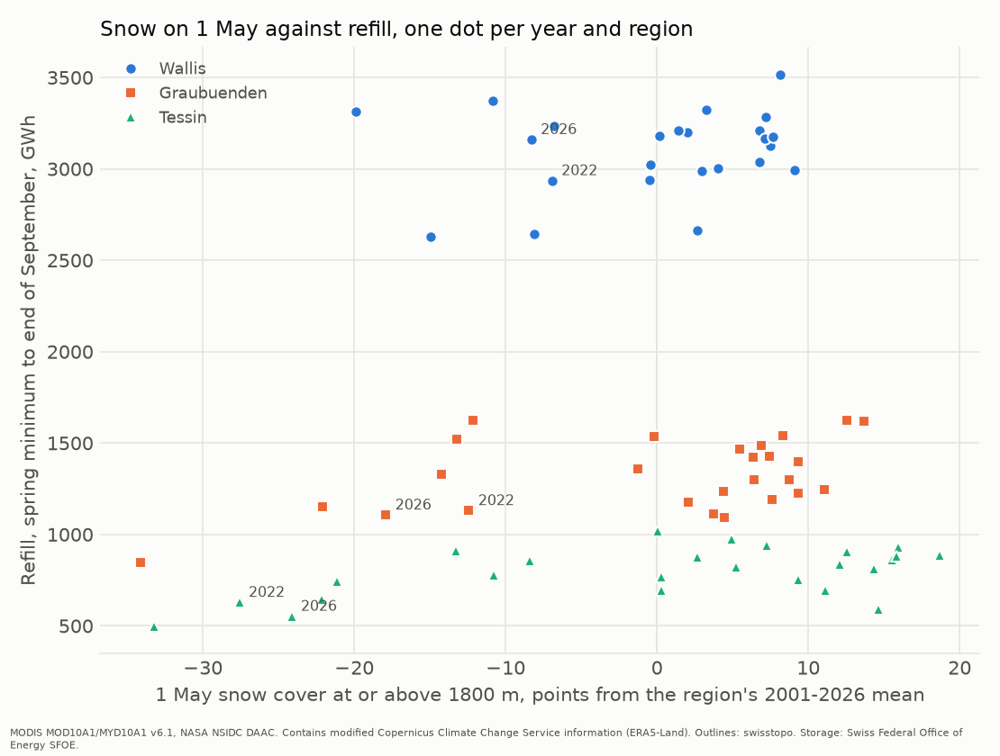

### 2026 case study

The walk-forward model for 2026 was fitted on 2002 to 2025 only. On 1 May 2026 the MODIS
snow cover of the three regions at or above 1800 m was 70% (8-day mean to 28 April), the
third lowest since 2002, and starting storage was 9.2% full.

| Forecast made on 1 May 2026 | End-of-September fill (points) | Forecast minus actual |
|---|---|---|
| Snow model (MODIS) | 82.6 | +8.6 |
| C1, starting storage only | 85.0 | +11.0 |
| C0, 10-year average | 85.7 | +11.7 |
| **Actual, 27 September 2026** | **74.0** | |

Snow pointed the right way: it cut 2.4 points from the storage-only forecast. But it
missed most of the shortfall. The 2026 drought was a summer story (a record low every week
from 5 July), which a 1 May snow reading cannot see. 2022 looks the same: forecast 85.5
against an actual 80.9.

### H3b: the forecast fill deviation and the October to December premium

x is the walk-forward 1 May forecast of the three-region end-of-September fill minus its
10-year norm. y is the mean daily CH minus DE-LU baseload spread from 1 October to
31 December. 11 years, 2015 to 2025.

- Slope: **−36.9 EUR/MWh per 10 points** (95% interval −76.1 to +2.3, HC3 standard
  errors, t with 9 df; two-sided p = 0.062). The sign is the expected one: a lower forecast
  fill goes with a higher Swiss premium.
- Clark-West against an intercept-only model (expanding window, at least 5 training years,
  test years 2020 to 2025): t = 2.79, one-sided **p = 0.019**, out-of-sample skill +0.25.
- **Smallest detectable effect: 54.5 EUR/MWh per 10 points** (80% power, 5% two-sided).
- The forecast deviations only range from −4.3 to +3.6 points, so "per 10 points" is an
  extrapolation. One year, 2021 (57 EUR/MWh at the start of the gas crisis), sits far above
  the rest. Six out-of-sample years cannot carry a claim.

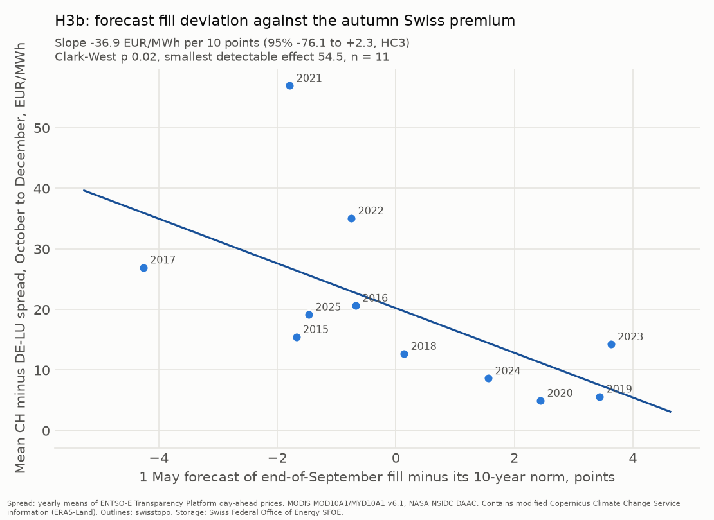

### Updated Holm table (secondary family)

| Test | Raw p | Holm-adjusted p | Below 0.05 |
|---|---|---|---|
| H3b: Clark-West, spread on forecast fill deviation | 0.019 | 0.058 | no |
| H3a: Clark-West, primary version against C1 | 0.134 | 0.268 | no |
| H2: Clark-West, CH minus IT-North, March to April | 0.987 | 0.987 | no |
| N1 | not run (deviation D14) | | |

No secondary test survives the Holm correction.

### Daily snow series and continuity

- MODIS: the 1800 m band every day from 24 February 2000 to 17 October 2026; the 2000 m
  band only 14 March to 5 May each year (deviation P1). 3.4% of 1800 m days fall below the
  70% valid share, most in May (16%) and June (10%), almost none in winter.
- Band areas (`reports/checks/snow_masks.json`), at or above 1800 m on the 500 m grid:
  Wallis 3,513 km² (68% of the canton), Graubuenden 4,815 km² (68%), Tessin 918 km² (33%),
  total 9,247 km² (61%). At 2000 m: 3,112, 4,018, 655 and 7,786 km². The 30 m DEM count
  agrees within 1%.
- **VIIRS continuity: not available in Earth Engine.** `NOAA/VIIRS/001/VNP10A1` is listed
  in the catalogue but cannot be loaded ("not found"), `NASA/VIIRS/002/VNP10A1_RAW` holds
  no images, and the `NASA/LANCE` VIIRS collections are fire products. The fallback check
  moves to weekend 5, with two candidates: NSIDC VNP10A1 through earthaccess (free
  Earthdata login) and the Copernicus HR-S&I fractional snow cover.

### MODIS fallback for the snow tracker (weekend 5)

NASA projects the end of MODIS science at Terra February 2027 and Aqua September 2027
([NASA Science](https://science.nasa.gov/science-research/earth-science/terra-the-end-of-an-era/),
updated 20 March 2026). Suomi NPP data delivery ends on 1 to 2 November 2026, so the
NOAA-21 product VJ210A1 was evaluated instead of VNP10A1 (deviation W1). The rule was
fixed before the comparison (W3): eligible if every canton correlates with MODIS at 0.9 or
more and the median publication lag is 5 days or less; then the lower mean absolute
difference.

| Region | Days | Correlation | Mean abs. difference (FSC) | Fit: MODIS = a + b VIIRS |
|---|---|---|---|---|
| Wallis | 539 | 0.988 | 0.046 | 0.087 + 0.932 x |
| Graubuenden | 525 | 0.992 | 0.044 | 0.049 + 0.982 x |
| Tessin | 524 | 0.987 | 0.053 | 0.049 + 0.993 x |
| Three regions | 536 | 0.993 | 0.043 | 0.059 + 0.969 x |

Pooled over the cantons: mean absolute difference 0.048. Median lag 0.3 days (90th
percentile 2.5 days, last 30 days). **VJ210A1 is eligible and is the fallback.** Copernicus
HR-WSI was not evaluated, because it was only to be tried if VIIRS failed (W2). The tracker
uses the corrected VIIRS value only after 7 days in a row without a valid MODIS day; it is
never used in an H3 test.

## Follow-up (post-hoc)

**Everything in this section is post-hoc.** The plan
([prereg/H3_FOLLOWUP_PLAN.md](../prereg/H3_FOLLOWUP_PLAN.md), tag
[v0.3-followup-plan](https://github.com/gerardorosch02/alpine-hydro/tree/v0.3-followup-plan))
was written on 2026-10-22, after seeing the H3a result and the 2026 miss, but before any
follow-up feature was computed or any model fitted. Nothing here changes a pre-registered
verdict, and its Holm family (four tests) is separate from the pre-registered one.

**Verdict (post-hoc): no added skill after 1 May.** The primary version, a 1 July update
for the three-region total (the 1 May FSC, storage at 1 July, positive degree-days above
2500 m times the glacier share, and precipitation since 1 May), beat storage alone by
almost nothing out of sample: skill against C1 +0.012, Clark-West p 0.080, Holm 0.241.

| Version (Total, walk-forward 2012 to 2026) | n | RMSE full | RMSE C1 | Skill vs C1 | Clark-West p | Holm p |
|---|---|---|---|---|---|---|
| **1 July update (primary)** | 15 | 3.22 | 3.24 | +0.012 | 0.080 | 0.241 |
| 1 June update | 15 | 2.81 | 3.52 | +0.364 | 0.051 | 0.205 |
| 1 August update | 15 | 3.66 | 3.06 | −0.432 | 0.580 | 1.000 |
| 1 April, FSC at or above 2500 m | 15 | 3.69 | 3.54 | −0.085 | 0.960 | 1.000 |

RMSE in percentage points of capacity. 2001 is dropped from the updates (no 1 May MODIS
feature) and 2002 from the 1 April version (fewer than 4 valid days), so every version
has 15 test years.

- The 1 June update is the only one with a sizeable gain (+0.364, p 0.051 before
  correction). It does not survive Holm, and the pattern across dates (June good, July
  flat, August worse) does not look like information that builds up over the summer.
- At or above 2500 m, late-March snow cover is close to saturated every year (mean FSC
  0.979, standard deviation 0.011, 2002 to 2025), so the higher band adds nothing on
  1 April either.
- Primary specification by canton (no correction, as the plan says): Wallis skill −0.465
  (p 0.240), Graubuenden −0.996 (p 0.832), Tessin +0.231 (p 0.049).
- Glacier share of land at or above 2500 m (GLIMS, Swiss Glacier Inventory 2016 epoch):
  Wallis 32.8%, Graubuenden 6.5%, Tessin 4.1%, three regions 20.2%. ERA5-Land cells are
  lower on average than 2500 m, so the degree-days are those of the cells holding high
  ground (the same caveat as the H3 SWE series).

**2026 case** (actual end-of-September fill 74.0%):

| Issue date | Full model | C1 (storage only) |
|---|---|---|
| 1 April (2500 m) | 85.1 | 85.1 |
| 1 May (H3a, pre-registered, for reference) | 82.6 | 85.0 |
| 1 June | 80.9 | 84.5 |
| 1 July | 79.5 | 83.6 |
| 1 August | 81.3 | 82.1 |

The summer terms move the 2026 forecast towards the outcome by 1 to 4 points against
storage alone, but every version still misses 2026 by 5.5 points or more. The record-low
2026 refill is not explained by melt degree-days or rain in these data.

Earth Engine (tag `alpinehydro-weekend5`): 2500 m polygons about 340 EECU-s for Tessin
(profiled), so roughly 0.3 to 0.4 EECU-hours for all three plus the one test chunk; data
pulls small (about 16 s of wall time per year). Machine-readable:
`reports/checks/h3_followup_results.json`.

## Water balance 2026 (post-hoc diagnostic)

**Label (post-hoc): weather story.** From the last Sunday of March to the last Sunday of
August 2026, less water came in than in any year since 2015, and operators took out less
energy than usual, not more. The inflow share of the storage shortfall is 7.01 at eta 0.75
(the rule needs at least 2/3); the label is the same at eta 0.70 and 0.80, and in every
secondary version.

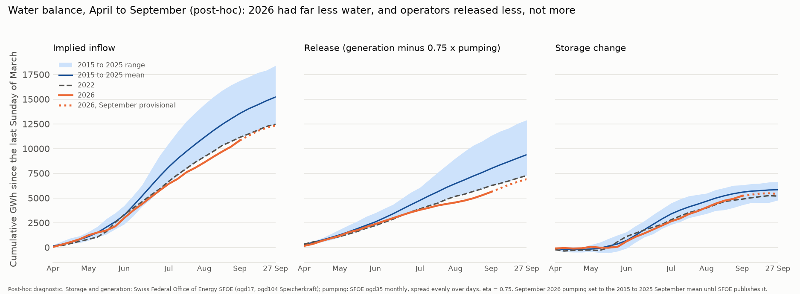

**Everything in this section is post-hoc.** The plan
([prereg/WATER_BALANCE_PLAN.md](../prereg/WATER_BALANCE_PLAN.md), tag
[v0.4-waterbalance-plan](https://github.com/gerardorosch02/alpine-hydro/tree/v0.4-waterbalance-plan))
was written on 2026-10-22, after seeing the 2026 miss, and pushed before any 2026 number
was computed. It is a diagnostic, not a test, and changes no earlier verdict. Choices the
plan did not fix are listed under "Deviations from the water balance plan". G is SFOE
ogd104 storage production (V1); P is SFOE ogd35 pumping spread over days.

### The 2026 and 2022 decompositions

Primary window, cumulative GWh. Baseline: the mean of 2015 to 2025 without the year itself
(2026: 11 years; 2022: 10 years). eta 0.75.

| | 2026 (29 Mar to 30 Aug) | 2022 (27 Mar to 28 Aug) | Baseline mean for 2026 | Baseline range for 2026 |
|---|---|---|---|---|
| Implied inflow | 10,834 | 11,137 | 13,471 | 11,137 to 16,423 |
| Release | 5,612 | 6,254 | 7,873 | 6,254 to 10,750 |
| Storage change | 5,222 | 4,883 | 5,598 | 4,289 to 6,305 |
| Inflow anomaly | −2,638 | −2,568 | | |
| Release anomaly | −2,261 | −1,781 | | |
| Storage-change anomaly | −376 | −787 | | |

Shares of the storage shortfall and the label, by eta:

| Year | eta | Inflow share | Release share | Label |
|---|---|---|---|---|
| 2026 | 0.70 | 6.88 | −5.88 | weather story |
| **2026** | **0.75** | **7.01** | **−6.01** | **weather story** |
| 2026 | 0.80 | 7.14 | −6.14 | weather story |
| 2022 | 0.70 | 3.24 | −2.24 | weather story |
| 2022 | 0.75 | 3.26 | −2.26 | weather story |
| 2022 | 0.80 | 3.28 | −2.28 | weather story |

The label does not change with eta. The shares are far above 1 because the two anomalies
almost cancel: 2,638 GWh less water came in, but operators released 2,261 GWh less, so
storage gained only 376 GWh less than usual over the window. A release share below zero
means operators did the opposite of draining the lakes.

In plain words: 2026 was a weather story. Its April to August inflow (10,834 GWh) was the
lowest since 2015, below 2022 (11,137). Operators held water back rather than letting it
out: release (5,612 GWh) was also the lowest since 2015. 2022 looks the same, a little
less extreme.

**Extra context, added after seeing these results (V9, descriptive, not part of the rule):**

- The release anomaly in 2026 splits into 1,530 GWh less storage generation (7,975 against
  9,504) and 976 GWh more pumping (3,151 against 2,175), of which 0.75 counts. Pumping has
  risen over the baseline years (1,349 GWh in 2015, 3,052 in 2025), so the eta term matters.
  With eta = 0 (pumping ignored entirely) the 2026 inflow share is still 5.06 and the label
  is the same.
- Much of the end-of-season gap was there before the refill began. On Sunday 29 March 2026
  storage held 1,166 GWh, 566 GWh below the baseline mean for that Sunday. On Sunday 30
  August it was 943 GWh below, and on 27 September 978 GWh below. So about 58% of the
  27 September gap was already missing at the end of March, and the refill season added the
  rest.

**Secondary results (never the label):**

| Version | 2026 inflow share at eta 0.70 / 0.75 / 0.80 | 2026 label | 2022 inflow share at eta 0.75 | 2022 label |
|---|---|---|---|---|
| (a) Provisional to 27 September, September pumping = 2015 to 2025 mean (375 GWh) | 6.96 / 7.07 / 7.19 | weather story | 4.31 (complete data) | weather story |
| (a) September pumping mean − 1 sd (297 GWh) | 6.84 / 6.95 / 7.05 | weather story | | |
| (a) September pumping mean + 1 sd (454 GWh) | 7.08 / 7.20 / 7.33 | weather story | | |
| (b) All-SFOE monthly, April to August (2026 provisional) | 7.36 / 7.48 / 7.59 | weather story | 4.08 | weather story |
| ENTSO-E B12 + B10 "partial fleet", primary window, baseline 2016 to 2025 | 4.84 / 4.97 / 5.10 | weather story | 3.07 | weather story |

To 27 September (provisional, eta 0.75, September at the mean), 2026 inflow was 2,914 GWh
below the baseline, release 2,502 GWh below, and the storage change 412 GWh below. The
update with SFOE's published September pumping is still to come.

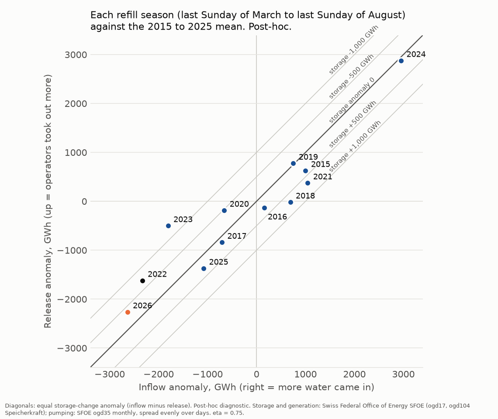

### Link to the snow forecast (provisional)

The H3a forecast made on 1 May 2026 said the three Alpine regions would be 82.6% full on
27 September. Starting from the H3a starting week (Sunday 26 April: three regions 9.2%,
national 12.1%) and keeping its forecast change in fill points, that is **85.5%**
nationally. Over the 22 weeks from 26 April to 27 September:

| | National fill on 27 September |
|---|---|
| H3a forecast, converted to national | 85.5% |
| The water that actually came in, with baseline release | 47.3% |
| Actual | 74.1% |

eta 0.75, September 2026 pumping at the baseline mean. Across eta 0.70 to 0.80 and
September pumping at the mean ± 1 sd, the middle row is 46.2% to 48.3%.

**The forecast missed the water, not the operators.** With normal releases, the water that
actually came in would have left storage near 47% full, 38 points below the forecast. The
forecast miss was 11.4 points; the water alone accounts for 3.3 times that (share 3.34),
and operators holding back closed about 27 points of it (share −2.34). The snow forecast
assumed a normal summer of inflow, and 2026's summer brought far less. This is
provisional until SFOE publishes September 2026 pumping.

### Descriptive only: release and price

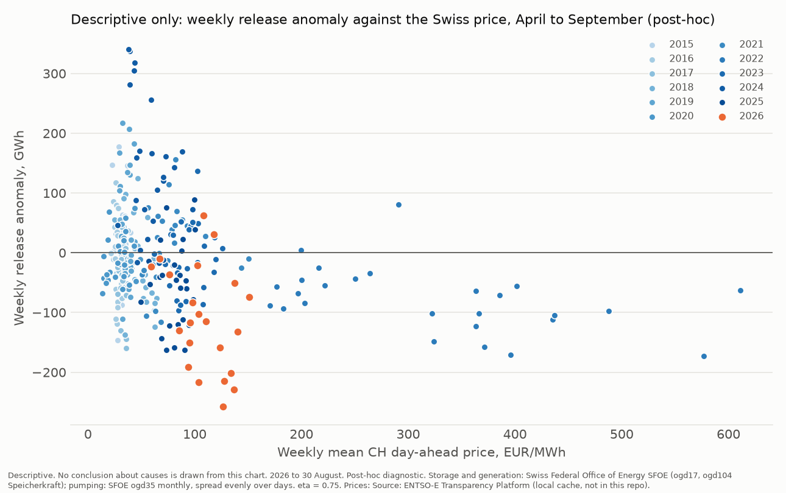

Weekly release anomaly (against the 2015 to 2025 mean of the same ISO week) against the
weekly mean CH day-ahead price, April to September, 2015 to 2026 (2026 to 30 August).
**Descriptive.** No conclusion about causes is drawn from it. The weekly prices come from a
local ENTSO-E cache and are not in this repo, so `alpinehydro demo` skips this figure and
keeps the committed PNG.

Machine-readable: `reports/checks/water_balance_results.json`.

### Audit (committed before any 2026 number)

**Kill criterion: triggered on ENTSO-E, resolved by switching G (V1).** ENTSO-E CH
reservoir plus pumped-storage generation (B12 + B10) is about 79% of SFOE storage
production. Against SFOE daily "Speicherkraft" (ogd104), summed over the same SFOE weeks
from 12 July 2015 to 27 September 2026:

| Comparison | n | Correlation | Mean difference | Median ratio | Within 10% |
|---|---|---|---|---|---|
| ENTSO-E B12 + B10 against ogd104, weekly | 586 weeks | 0.922 | −22.0% | 0.786 | 11.4% |
| ENTSO-E B12 + B10 against ogd35, monthly | 134 months | 0.919 | −21.7% | 0.787 | 9.0% |
| ogd104 against ogd35, monthly | 140 months | 0.9999 | +0.04% | 1.000 | 100% |

The ENTSO-E share is not stable: the median weekly ratio by year runs from 0.67 (2015) and
0.68 (2016) to 0.82 or 0.83 (2018, 2019, 2025, 2026), with 0.75 to 0.76 in 2021 to 2023,
and no steady trend. More than half of the weeks
differ by more than 10%, so the plan's stop rule applied. The owner chose to take G from
ogd104, which matches the SFOE monthly electricity statistics within 0.4% in every month
from 2015 to 2025 (2026 is provisional; its largest monthly difference is 5.1%). The
ENTSO-E version is kept as a secondary "partial fleet" result (V4).

**Coverage.** ENTSO-E B12 and B10 have no missing hour from 1 July 2015 to 27 September
2026 and no gap week. ogd104 has every day from 1 January 2015 to 22 October 2026. SFOE
ogd35 pumping runs to August 2026 (2026 provisional), so the primary window ends on the
last Sunday of August. Baseline years with G from ogd104: 2015 to 2025 (none dropped).

**Implied inflow looks like hydrology** (G from ogd104, weeks up to 28 December 2025):

| Check | eta 0.70 | eta 0.75 | eta 0.80 |
|---|---|---|---|
| Weeks with negative implied inflow, all (573 weeks) | 0.2% | 0.2% | 0.2% |
| Weeks with negative implied inflow, April to September | 0% | 0% | 0% |
| Peak month (mean weekly inflow, 2015 to 2025) | June, 970 GWh | June, 964 GWh | June, 958 GWh |
| Annual total, 2016 to 2025, range | 16,062 to 23,649 GWh | 15,786 to 23,409 GWh | 15,510 to 23,169 GWh |
| Annual total, 2016 to 2025, mean | 19,014 GWh | 18,790 GWh | 18,566 GWh |

Mean weekly implied inflow by month at eta 0.75 (GWh): January 84, February 74, March 92,
April 203, May 497, June 964, July 792, August 629, September 414, October 284, November
180, December 117. The lowest year is 2022 and the highest 2024.

**External check: HP-CatCH.** Annual implied inflow (eta 0.75) against HP-CatCH simulated
natural reservoir inflow (ETH Zurich, PREVAH, CC BY 4.0, summed over its 107 reservoirs),
2016 to 2022: correlation **0.921** (n 7). HP-CatCH also has 2022 as its lowest of those
years (10,591 hm³) and 2017 next (10,857 hm³). Seven years is few, so this says the series
moves with simulated hydrology, not that the levels are right.

Machine-readable: `reports/checks/water_balance_audit.json`. Committed inputs:
`data/processed/water_balance/` (weekly and monthly GWh aggregates and the HP-CatCH annual
volumes). Credit: Source: Swiss Federal Office of Energy SFOE. Source: ENTSO-E
Transparency Platform. HP-CatCH: Haddad et al., ETH Zurich, doi:10.3929/ethz-c-000800479.

## Deviations from the pre-registration

The frozen text is `prereg/PREREGISTRATION.md` at tag `v0.1-prereg`; it is not edited.
Every entry below clarifies a point the text leaves open, or records a data access
choice. All were fixed on **2026-10-21, before any price model was fitted** (this section
was committed before the first fit). None changes a rule after seeing a result.

| # | Date | Point | Choice | Reason |
|---|---|---|---|---|
| D1 | 2026-10-21 | Month used for the dummies, B0 and B2 | The valid Sunday's month | Origins from late-April Sundays fall on a Thursday in May; the valid Sunday keeps the six season months that define the sample. |
| D2 | 2026-10-21 | Winsorising test rows | Test x and test y are clipped at the training cut-offs, and the primary scores use that clipped y. A robustness score uses the raw test y. | The text winsorises "y and x" with training cut-offs; applied literally. Cut-offs from pre-crisis training years clip the 2021/22 and 2022/23 test winters, so both scores are reported. |
| D3 | 2026-10-21 | The "in-sample slope" | Full model on all origins 2015/16 to 2025/26, full-sample cut-offs, Newey-West lag 4 (8 as robustness). Rule 2 uses the 95% interval as written; TOST p-values are reported beside it. | The text says "95% interval … (TOST at 5%)", but TOST at 5% corresponds to a 90% interval. The rule's wording (95%) is applied; the inconsistency is noted, not resolved in either direction after results. |
| D4 | 2026-10-21 | Crisis-excluded variant | 2021/22 and 2022/23 are dropped from training and test; test winters 2023/24 to 2025/26 | A variant "without the crisis winters" should not learn from them either. |
| D5 | 2026-10-21 | Clark-West and Diebold-Mariano on overlapping weekly targets | Errors pooled over the 5 test winters. Clark-West: Newey-West lag 4 variance, one-sided normal p. Diebold-Mariano: variance with lags 1 to 3, Harvey-Leybourne-Newbold correction with h = 4, two-sided t p with n − 1 df. | Consistent with the lag-4 primary test; h = 4 weeks of overlap for a 28-day target from weekly origins. |
| D6 | 2026-10-21 | B1 window | The 28 delivery days ending the day before the origin day | Conservative reading of "the 28 days before the origin". |
| D7 | 2026-10-21 | Bootstrap | 2,000 resamples of whole winters, seed 20261021. Slope: the 11 winters resampled and re-winsorised each time. Out-of-sample R² against B3: the 5 test winters resampled. | Five test winters give only 126 distinct resamples, so that interval is coarse. |
| D8 | 2026-10-21 | H2 specification | Origins with a valid Sunday in March or April; target the 28-day CH minus IT-North spread; the H1 controls; the same folds; test = one-sided Clark-West of the full model against B3. Holm family "H2 only so far", recomputed when H3b and N1 are added. | The text names H2 but no test. |
| D9 | 2026-10-21 | Gaps in the controls | Each generation control is the mean MW over all available hours in its window; partial days count with the hours they have. Pre-stated floor: a window with less than 90% of its expected hours (or days, for HDD) sets that control to missing and drops the origin from that model. Dropped: 0 origins in every model (lowest coverage 96.3%, French nuclear). | French nuclear has 27 days with 1 to 3 missing hours and 2026-01-01 with 1 of 24 hours (confirmed at the source), some inside test-winter windows. "Mean MW over the window" read literally. |
| D10 | 2026-10-21 | HDD source | ERA5-Land daily aggregates through Earth Engine (`ECMWF/ERA5_LAND/DAILY_AGGR`), country outlines `USDOS/LSIB_SIMPLE/2017`, area-weighted with pixel areas over land cells | Same dataset as the Copernicus portal named in the text; a different access route. |
| D11 | 2026-10-21 | Crisis-interaction variant | Full-sample in-sample OLS with x, a crisis-winter dummy and x × crisis (2021/22, 2022/23) | The text asks for "a crisis-winter interaction on the slope"; the level dummy keeps the interaction from absorbing a level shift. Reported only; not part of the rule. |
| D12 | 2026-10-21 | Verdict labels | If rule line 2 holds: "no effect (equivalence)". Else if line 1 or 3 holds: "no edge". Else: "edge". | The rule defines "no edge"; line 2 is the equivalence case, the stronger statement. |
| D13 | 2026-10-21 | Benchmark inputs | B1 and B2 use the raw 28-day spread before the origin (not winsorised); B0 and B2 average the clipped training y; controls are not winsorised | The text winsorises only x and y. |
| D14 | 2026-10-21 | N1 (satellite nowcast of the next SFOE release) | Not run. The Holm family is H2, H3a and H3b. | Part A was closed after the Wallis validation, and the timing ceiling was about EUR 0.2/MWh (section 7 of the pre-registration). Decided in weekend 4, before any H3 fit. |
| D15 | 2026-10-21 | HDD source for live origins (winter 2026/27 only) | Live CH and DE HDD come from the Copernicus CDS ERA5-Land daily statistics (the source named in the pre-registration), with the same country outlines and area weights as D10. Before first use, the CDS and Earth Engine values are compared on days both hold. The backtest keeps Earth Engine (D10). | Earth Engine's ERA5-Land runs about 10 days behind (11 October on 21 October), so a live HDD window ending 7 days before the origin is only about 89% covered and fails the D9 floor. CDS publishes after about 6 days, as the pre-registration assumed. Found in a dry run on 2026-10-21; owner's choice; decided before any live forecast. |

## Deviations from the H3 analysis plan

The plan is `prereg/H3_ANALYSIS_PLAN.md` at tag `v0.2-h3plan`; it is not edited. Every
entry was decided on **2026-10-21**. P1 to P5 were fixed before the first H3 fit; P6 to P8
concern reporting only.

| # | Date | Point | Choice | Reason |
|---|---|---|---|---|
| P1 | 2026-10-21 | MODIS 2000 m band | Pulled only for 14 March to 5 May of each year; the 1800 m band is daily throughout. | EECU budget (owner's choice). The 2000 m features only need the 1 April and 1 May windows, so every planned 2000 m test is still run. |
| P2 | 2026-10-21 | How the band mask is applied | The 500 m band mask is turned into polygons once per canton and band on the MODIS grid (`data/processed/snow/band_polygons.geojson`), and daily values are summed per polygon. Total is built from the canton sums. | Recomputing the mask from the 30 m DEM cost about 600 EECU-s per call, and a union of the three cantons failed in Earth Engine ("object too large"). Same pixels: polygon areas match the raster areas within 0.1%, and Total is still the mean over all valid pixels of the three cantons. |
| P3 | 2026-10-21 | Test years when a feature year is missing | "At least 10 training years" is applied after dropping years with a missing feature. MODIS 1 May (Total) loses 2001, so its first test year is 2012 (15 test years). Wallis MODIS 1 May loses 2001 and 2012 (14 test years). | The plan says both "test years 2011 to 2026" and "at least 10 training years". When a year is missing they conflict; the training floor was kept. |
| P4 | 2026-10-21 | End of the daily series | Each series stops on the last day with an image (MODIS 17 October 2026, ERA5-Land 11 October 2026). | So no day is filled only by carrying earlier days forward. No test uses these days. |
| P5 | 2026-10-21 | H3b target in the repo | One number per year (`data/processed/snow/h3b_q4_spread.csv`, from cached ENTSO-E prices) is committed, as the weekend 4 brief asked. | This relaxes the weekend 1 note that no derived statistics of ENTSO-E price levels are committed. Eleven yearly means are a minimal extract, credited to the ENTSO-E Transparency Platform. No daily or hourly price is committed. |
| P6 | 2026-10-21 | Extra numbers | The full-sample snow slope of each version, and Diebold-Mariano in leave-one-year-out, are also reported. | Description only; neither enters the verdict. |
| P7 | 2026-10-21 | Snow against refill figure | The x axis is each region's 1 May FSC minus its own 2001-2026 mean. | Display only. It uses all years and is not a forecast feature. |
| P8 | 2026-10-21 | VIIRS continuity check (weekend 4 brief, not the plan) | Not done; moved to weekend 5. | No usable VIIRS snow collection in Earth Engine (see "Daily snow series and continuity"). |

## Deviations from the weekend 5 plan (MODIS fallback)

The weekend 5 brief fixed the fallback candidates and the selection rule before any
candidate was compared with MODIS. These entries were written on **2026-10-21**, before any
fallback data were downloaded. The rule itself (correlation at least 0.9, typical
publication lag at most 5 days, then the lower mean absolute difference) is unchanged.

| # | Date | Point | Choice | Reason |
|---|---|---|---|---|
| W1 | 2026-10-21 | VIIRS product | NSIDC VJ210A1 v2 (NOAA-21 VIIRS, same algorithm, variable and 375 m sinusoidal grid) replaces VNP10A1. | Suomi NPP data delivery ends on 1 or 2 November 2026 (NOAA and NASA Earthdata notices), so VNP10A1 cannot serve as a live fallback. NOAA names NOAA-21 as the primary successor. Owner's choice. |
| W2 | 2026-10-21 | Copernicus candidate | Copernicus HR-S&I ended in February 2025; its successor HR-WSI (Copernicus Data Space Ecosystem) is evaluated only if VJ210A1 fails the eligibility rule. In that case the daily gap-filled 60 m product (GFSC) replaces the 20 m FSC, and the owner is asked before a CDSE account is created. | HR-S&I no longer exists. The 20 m FSC is one file per Sentinel-2 pass (not daily) and about 20 GB for two winters. Owner's choice. |
| W3 | 2026-10-21 | Details the brief left open | FSC from the VIIRS `NDSI_Snow_Cover` (0 to 100) with the same Salomonson and Appel formula as MODIS. Same 8-day per-pixel gap fill and 70% valid-share rule. Band: the committed MODIS band polygons, rasterised by pixel centre on the 375 m grid. Correlation: Pearson on days where both are valid, 1 October to 30 June of 2024/25 and 2025/26, computed per canton; the candidate is eligible only if every canton reaches 0.9. Mean absolute difference: pooled over the three cantons. Typical publication lag: the median, over the granules of the last 30 days, of the time between the end of the acquisition day and the granule's first appearance in NASA CMR. | Fixed before any fallback value was seen. |

## Deviations from the water balance plan

The plan is `prereg/WATER_BALANCE_PLAN.md` at tag `v0.4-waterbalance-plan`; it is not
edited. Everything in it is post-hoc. V1 to V6 were written on **2026-10-22, before any
2026 or 2022 balance, anomaly or comparison was computed**.

| # | Date | Point | Choice | Reason |
|---|---|---|---|---|
| V1 | 2026-10-22 | Kill criterion and the source of G | Kill criterion triggered (ENTSO-E B12+B10 is about 79% of SFOE storage production, 11% of weeks within 10%). G switched to SFOE ogd104 daily Speicherkraft, the official full-coverage series, before any 2026 computation. G is now storage plus pumped-storage generation as one series. | Owner's choice after the stop. ogd104 summed by month equals the ogd35 monthly storage-plant generation within 0.4% in every month from 2015 to 2025 (mean difference 0.04%), while the ENTSO-E share drifts from 0.68 (2016) to 0.83 (2026) by year, so no fixed scale factor fixes it. |
| V2 | 2026-10-22 | Pumping P | Still SFOE ogd35 monthly pumping spread evenly over days, as the plan says. | ogd104 has no pumping series (its categories are Flusskraft, Kernkraft, Photovoltaik, Speicherkraft, Thermische and Wind). |
| V3 | 2026-10-22 | Baseline years | 2015 to 2025 (11 years; for 2022, the other 10). Sanity annual totals 2015 to 2025, HP-CatCH correlation 2015 to 2022, secondary (a) September pumping mean and standard deviation over 2015 to 2025. | ogd104 covers every day from 2015-01-01 to 2026-10-22, so 2015 has no gap week under the plan's rule. The plan's "2016" in sections 7 and 9 assumed the ENTSO-E start of 1 July 2015; the brief asked for 2015 to 2025. |
| V4 | 2026-10-22 | ENTSO-E version | Reported as a secondary "partial fleet" result with G = ENTSO-E B12 + B10 and baseline 2016 to 2025 (2015 has gap weeks). Never the label. | Owner's choice; it shows how much the label depends on the generation source. |
| V5 | 2026-10-22 | Where the code lives | `src/alpinehydro/fetch/sfoe_daily.py`, `src/alpinehydro/water_balance.py`, `src/alpinehydro/water_balance_audit.py`, `src/alpinehydro/plots_water_balance.py` and `scripts/hpcatch_annual.py`, not `fetch/` and `analysis/` at the top level. | The repo is one package under `src/alpinehydro/`; there is no `analysis/` folder. |
| V6 | 2026-10-22 | HP-CatCH comparison | `inflows_direct` (PREVAH simulated, m³/s hourly, each sub-basin counted once) summed over its 107 reservoirs, calendar-year volume in hm³, against calendar-year implied inflow in GWh. Pearson correlation only, since the units differ. | The dataset's own reservoir inflow series. Its time axis has 8,760 hours in every year (no 29 February), so leap years lose one day. |
| V7 | 2026-10-22 | 2015 annual total | Not computed, so the annual range and the HP-CatCH correlation use 2016 onwards. 2015 stays in the April to August and April to September baselines. | The 2015 calendar-year window starts with the week of Monday 29 December 2014, before ogd104 begins on 1 January 2015. |
| V8 | 2026-10-22 | Baseline release in the snow link | For each baseline year (2015 to 2025), the release over the same 22 weeks, starting from the last Sunday on or before 26 April of that year. | The plan says "over the same weeks" without fixing how weeks map across years. Set while coding, before the link was first run. |
| V9 | 2026-10-22 | Extra context in the results | Storage level at the window ends against the baseline, the split of the release anomaly into generation and pumping, and the shares at eta = 0. | **Added after seeing the results.** Descriptive only; it does not touch the rule or the label. The rise in pumping over the baseline years made the eta term worth bounding. |
| V10 | 2026-10-22 | Figure `water_balance_years.png` | Every year against the 2015 to 2025 mean, including the year itself. | One common reference makes the dots comparable. The decomposition tables leave the year out, so the 2022 dot differs slightly from the 2022 row. Display only. |
| V11 | 2026-10-22 | Descriptive scatter | Release anomaly against the 2015 to 2025 mean of the same ISO week (week 53 counted as 52). Weekly prices are not committed; `alpinehydro demo` skips the figure with the note "release_vs_price skipped: needs local ENTSO-E prices". | Owner's choice: a weekly price series is what the ENTSO-E decision of 22 October keeps out of the repo, and a descriptive chart is not worth loosening that. |
